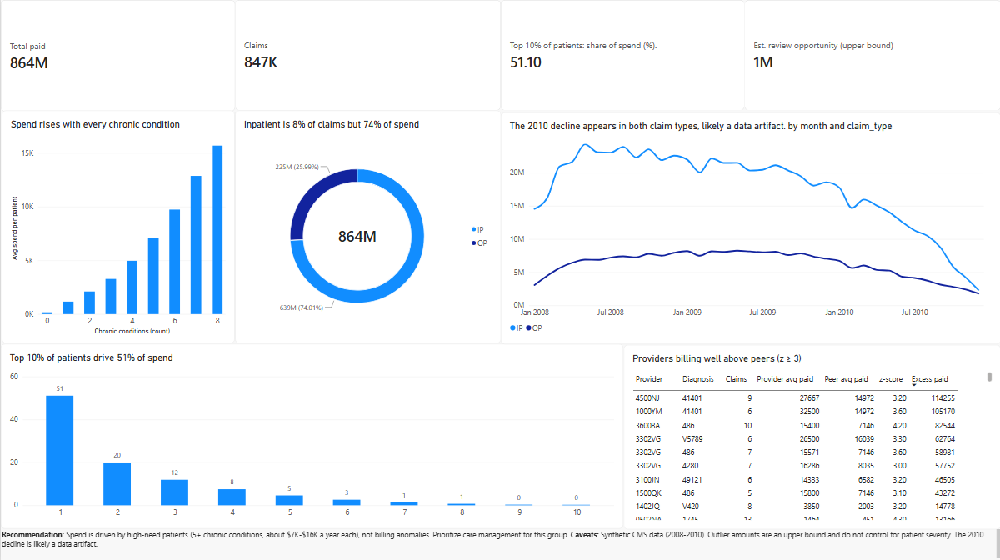

# Healthcare Claims Cost & Leakage Analysis

**Question:** Where does spend concentrate in a Medicare claims population, and are billing anomalies or high-need patients the bigger cost driver?

**Tools:** PostgreSQL, Python (pandas, SQLAlchemy), Power BI

**Data:** CMS DE-SynPUF Sample 1 (synthetic Medicare claims, 2008-2010)

## Key findings

| Finding | Result |

|---|---|

| Claims analyzed | 846,520 (after merging 11,043 duplicate-key segments), $863.8M paid |

| Inpatient claims | 7.9% of claims, 74% of spend |

| Patient concentration | Top 10% of patients drive 51% of spend; top 30% drive 83% |

| Chronic conditions | Average 2009 spend per patient rises from $166 (0 conditions) to $15,682 (8 conditions) |

| Duplicate payments | 114 potential groups, about $20.5K (0.002% of spend) |

| Provider outliers | 154 of 8,485 provider-diagnosis pairs (z >= 3 vs peers), about $1.0M (0.12% of spend, upper bound) |

**Conclusion:** Spend is driven by high-need patients, not billing anomalies. Care management for patients with 5+ chronic conditions is the stronger lever.

## Method

1. Loaded beneficiary, inpatient and outpatient files into PostgreSQL (`load_data.py`)

2. Built a unified claims table and a cleaned version that merges claim segments, reconciled so total paid is unchanged (`sql/01` to `sql/04`)

3. Ran spend concentration by patient decile, cost drivers by chronic condition count, a duplicate-payment check, provider peer benchmarking by diagnosis and claim type (z-score), and a monthly trend (`sql/03`, `sql/05` to `sql/10`)

4. Exported summary tables to `exports/` and built the Power BI dashboard (`dashboard/`)

## Data quality notes

- 32,265 zero-paid claims and 5,715 missing diagnoses were kept, and excluded from provider benchmarks where relevant

- Monthly spend falls 46% in 2010 while beneficiary counts fall only 3%; this is likely a data artifact, so single-year comparisons use 2009

- Merged segments were almost all outpatient (10,975 outpatient vs 68 inpatient)

## Caveats

- Synthetic, de-identified data from 2008-2010. Results show what the method would flag, not real overbilling

- Provider benchmarking matches on first diagnosis and claim type only and does not adjust for patient severity

- Outlier dollar amounts are an upper bound, and some flags will be chance

## Reproduce

1. Download DE-SynPUF Sample 1 from CMS into `data/` (not included in the repo)

2. Set the database password: `set PGPASSWORD=...`, then run `python load_data.py`

3. Run `sql/01` through `sql/10` in order in PostgreSQL

4. Open `dashboard/claims_dashboard.pbix` in Power BI Desktop

